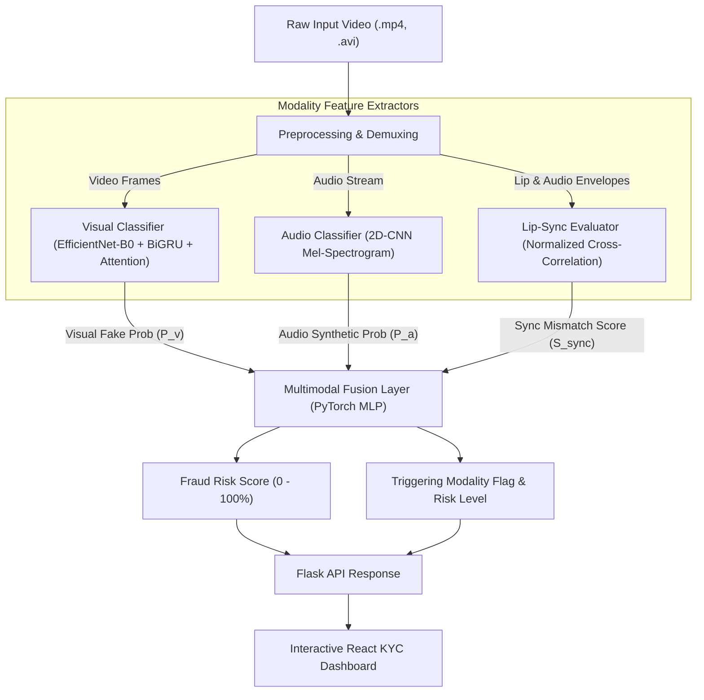

# System Architecture - Multimodal Audio-Video Fraud & Deepfake Detection

## 1. Overview & CoE Alignment

The **Multimodal Audio-Video Fraud & Deepfake Detection System** is designed to mitigate identity fraud and executive impersonation in live video verification and KYC (Know Your Customer) workflows. Rather than analyzing video or audio in isolation, the system evaluates cross-modal consistency between visual facial motion, acoustic speech cues, and lip-audio temporal synchronization.

This cross-modal forensic strategy catches sophisticated attacks (e.g., face-swapping combined with cloned audio or dubbed audio playback) where individual modalities might look or sound convincing in isolation.

---

## 2. End-to-End Architecture Diagram

---

## 3. Subsystem Specifications

### 3.1 Visual Classifier (`models/video_model.py`)
- **Backbone**: EfficientNet-B0 pretrained feature extractor (outputs 1280-dim frame representations).
- **Temporal Modeling**: Bidirectional GRU (2 layers, hidden dimension 256) captures frame-to-frame facial movement and unnatural blinking/swapping boundaries.
- **Attention Mechanism**: Temporal attention scores weight key frame features to handle partial video occlusion.
- **Output**: Visual Deepfake Probability $P_{video} \in [0, 1]$.

### 3.2 Audio Classifier (`models/audio_model.py`)
- **Preprocessing**: Extracts 128-band Mel-spectrogram from 4-second 16kHz audio clips ($128 \times 251$ dimensions).
- **Architecture**: 4-Block 2D Convolutional Neural Network with BatchNorm, ReLU activation, and Adaptive Average Pooling.
- **Output**: Synthetic Speech Probability $P_{audio} \in [0, 1]$.

### 3.3 Lip-Sync Mismatch Detection Engine (`models/sync_model.py`)
- **Feature Extraction**:
  - *Audio Envelope*: Short-Time RMS energy envelope resampled to match frame rate.
  - *Lip Motion*: Normalized vertical lip-opening trajectory extracted from face keypoints/gradients.
- **Scoring**: Computes zero-mean Normalized Cross-Correlation (NCC) across bounded frame lags $[-5, +5]$:
  $$\text{NCC}(\tau) = \frac{\sum (A_t - \bar{A})(L_{t+\tau} - \bar{L})}{\sqrt{\sum (A_t - \bar{A})^2 \sum (L_{t+\tau} - \bar{L})^2}}$$
- **Mismatch Score**: $S_{sync} = \text{clip}(1.0 - \max_\tau \text{NCC}(\tau) + \text{LagPenalty}, 0, 1)$.

### 3.4 Multimodal Fusion Layer (`models/fusion_model.py`)
- **PyTorch Network**: Multi-Layer Perceptron ($3 \to 32 \to 16 \to 1$) trained with Binary Cross-Entropy Loss to predict combined fraud probability.
- **Fallback Weighted Scoring**:
  $$\text{Risk Score} = 0.50 \cdot P_{video} + 0.30 \cdot P_{audio} + 0.20 \cdot S_{sync}$$

---

## 4. API & Dashboard Integration

- **Backend (Flask API)**: Exposes `/health`, `/predict`, `/sample_videos`, and `/predict_sample` endpoints.
- **Frontend (React Dashboard)**: Provides real-time KYC fraud risk gauges, visual tri-modality score breakdown, forensic rationale banners, and reviewer approval controls.
